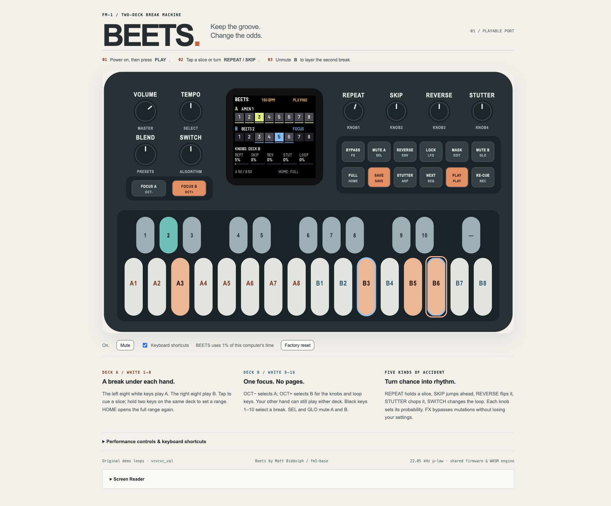
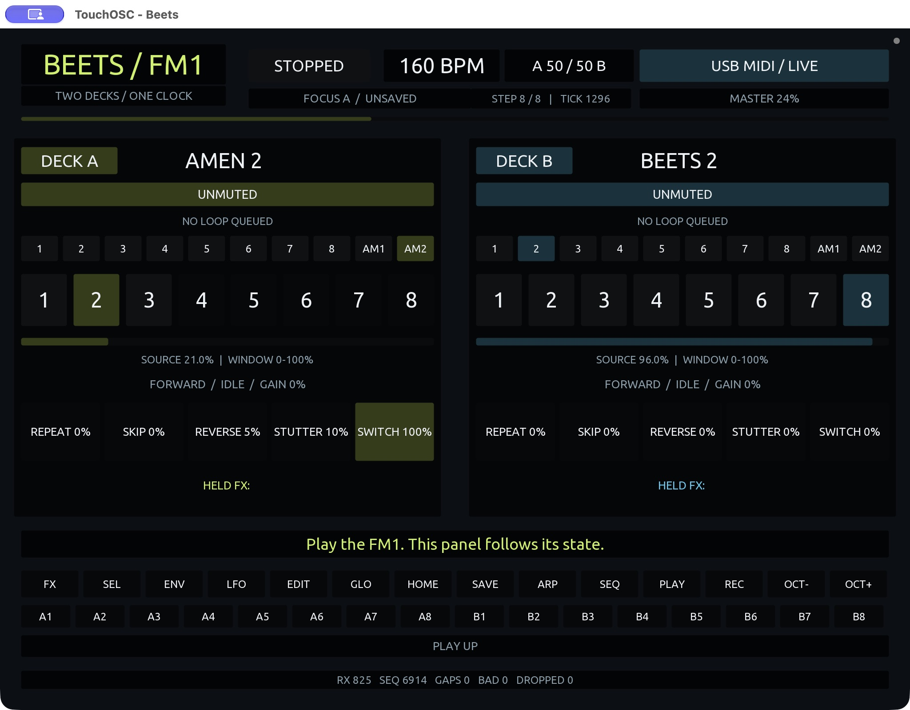

# Beets for FM-1

Beets is a sample slicer for FM-1, ported from
[Matt Biddulph's Norns app](https://github.com/mattb/beets) using
[fm1-base](https://github.com/charlesvestal/fm1-base). Each deck plays eight slices
from a loop. Repeat, skip, reverse, stutter and loop-switch probabilities change
the sequence as it plays.

The hardware firmware, native simulator and browser emulator run the same engine
and the same ten demo loops. Original recordings are preserved in `assets/source/`.
The samples are converted to mono 22.05 kHz mu-law to fit internal flash, then
interpolated during playback. This conversion reduces audio fidelity.



*The WASM app running in Chrome during a smoke test.*

## Build and play

```sh
tools/setup-local.sh
tools/build-local.sh --all
tools/serve-local.sh
```

Open **http://localhost:8081**, power on, then press **PLAY**. Deck A starts with
the first Beets break; deck B is muted initially. Press **GLO / MUTE B** to layer it.

Individual targets:

```sh
tools/build-local.sh --host    # app/build/host/beets_host
tools/build-local.sh --web     # app/build/emu/
tools/build-local.sh           # app/build/beets.fwsc
```

The wrapper uses `.venv` and the existing JieLi toolchain/SDK under
`~/.jieli`. Firmware compilation requires Docker Desktop running. Host and WASM
builds do not need Docker. The compiler and SDK are not Git dependencies.

Required tools: C compiler, Python 3.14 + Pillow 13, ffmpeg, Emscripten, and for
firmware the JieLi pi32v2 Linux compiler plus AC79 SDK
`AC79NN_SDK_V1.2.1_2023-12-13`. `tools/setup-local.sh` initializes submodules and
the Python environment; install the other tools separately.

```sh
brew install emscripten ffmpeg
sh fm1-base/tools/get_toolchain.sh
git clone --depth 1 --branch AC79NN_SDK_V1.2.1_2023-12-13 \
  https://gitee.com/Jieli-Tech/fw-AC79_AIoT_SDK.git "$HOME/.jieli/fw-AC79_AIoT_SDK"
```

`JIELI_TOOLCHAIN` and `AC79_SDK` can override the wrapper's default locations.
`FM-1_731` is this port's locally chosen package prefix. It has no global registration.

## Controls

| Physical control | Beets action |
| --- | --- |
| White keys 1-8 / 9-16 | Deck A / B slices; tap to cue, hold two for a range |
| OCT- / OCT+ | Focus A / B for the knobs and loop selection |
| Black keys 1-10 | Select one of the ten demo loops for the focused deck |
| Black key 11 | Unassigned |
| PLAY | Start/stop both decks together |
| REC | Cue both decks to their range starts on the next eighth-note |
| SELECT | Tempo |
| PRESETS | Blend A / B |
| ALGORITHM | Probability of switching loops |
| KNOB 1 / 2 / 3 / 4 | Repeat / skip / reverse / stutter probability |
| SEL / GLO | Mute A / B |
| FX | Bypass focused deck's mutations, retaining their settings |
| ENV / ARP (hold) | Force reverse / stutter |
| LFO | Lock the current slice; press again for the full range |
| HOME | Return the focused deck to its full slice range |
| SEQ | Automatically advance loops |
| EDIT (hold) + white / black | Toggle eligible slices / loops |
| SAVE | Store the current setup while stopped |
| MASTER | Output volume |

Focus selects the deck for the knobs and loop keys. Each white-key group keeps
playing its assigned deck. The display shows both decks and the focused deck's
probabilities on one screen.

Browser shortcuts work while the panel is focused: `P` transport, `Z`/`X` focus,
`QWERTYUI` A slices, `ASDFGHJK` B slices, `1...0` loop selection, `Esc` full range.
Drag or scroll a knob, or focus it and use arrow keys. Shift-click can hold keys
for range chords with one pointer.

## Platform dependency

`fm1-base` is a pinned Git submodule that the wrappers initialize automatically. Set `FM1_BASE=/path/to/fm1-base` to use a shared checkout instead;
external checkouts must already have the required patches. See [dependency setup](docs/DEPENDENCIES.md)
for the explicit patch step, shared-checkout workflow and upgrading the pin.

## Repository layout

- `app/`: app callbacks, device UI, settings, DSP and browser panel.
- `assets/source/`: unchanged upstream demo recordings and provenance.
- `tools/`: local setup/build/serve tools and sample-bank generator.
- `tests/`: engine and runtime checks.
- `fm1-base/`: pinned upstream submodule; its `bsp/` is a nested submodule.
- `build/` and `app/build/`: ignored logs, generated data and build artifacts.

Change the app without editing the platform. Upgrade the submodule deliberately,
then rebuild and run tests before recording the new Git link.

The C engine implements Beets' sequencing and sample playback. Softcut, Norns
sample loading/edit pages, crow integration and arc hardware support are omitted.
See the [current verification record](docs/VERIFICATION.md) for builds, installed
firmware, hardware USB checks and remaining physical audio/control coverage gaps.

## USB MIDI visualizer feed

Firmware 0.2.0 and later emit ASCII JSON in versioned SysEx over class-compliant USB MIDI:
full state at sixteenth-note boundaries, input edges/deltas, and stopped heartbeats.
Open [the TouchOSC prototype](touchosc/Beets.tosc), with [setup instructions](touchosc/README.md),
or see [the protocol and receiver example](docs/TELEMETRY.md).



*TouchOSC on macOS receiving the FM1 state over USB MIDI, with transport stopped.*

```sh
.venv/bin/python tools/monitor-midi.py --list
.venv/bin/python tools/monitor-midi.py --port 'X0X FM-1'
# Connected-device smoke test; temporarily operates transport and panel controls:
.venv/bin/python tools/smoke-usb-midi.py --port 'X0X FM-1'
```

The monitor and hardware test require `mido` and `python-rtmidi`. The build wrapper
applies `patches/fm1-base-telemetry.patch` idempotently to the pinned upstream
submodule for atomic nonblocking SysEx output; the submodule therefore appears
modified after setup. The bounded JSON serializer is vendored MIT-licensed
[jems](app/vendor/jems/PROVENANCE.md), with ASCII Unicode escaping adaptations.

For another instrument, see the [Norns porting guide](docs/NORNS-PORTING.md) and
[visualizer integration guide](docs/TELEMETRY-BEST-PRACTICES.md).
[Telemetry measurements](docs/TELEMETRY-PERFORMANCE.md) cover the cost on FM1.
